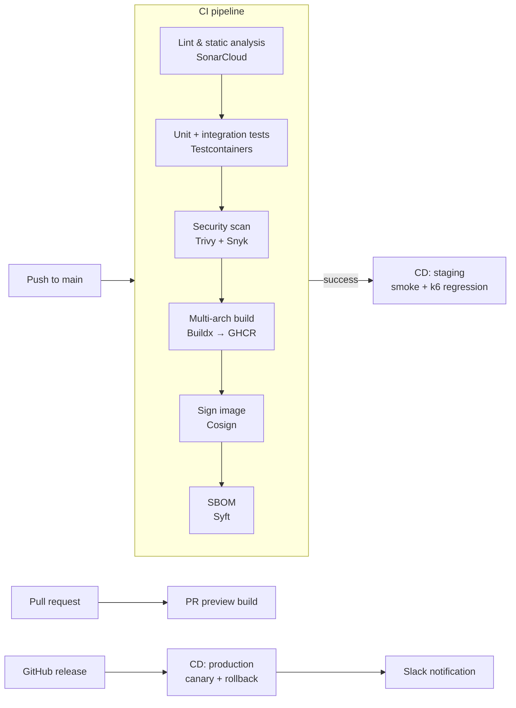

# Kubernetes CI/CD Pipeline — GitHub Actions, Docker, Skaffold & k6

A reference DevOps pipeline for shipping a containerized service to Kubernetes: multi-arch Docker builds, signed images with SBOMs, security scanning, staging/production promotion, per-PR preview environments, autoscaling and load testing.

> **Status: work in progress.** The CI pipeline, Dockerfile, Kubernetes base manifests and local dev loop are implemented. Deployment steps in the CD workflows are scaffolded (they log instead of calling `kubectl`), and the Helm chart, Kustomize overlays, Terraform and monitoring configs are planned. See [Roadmap](#roadmap).

## Pipeline overview



## What's implemented

| Area | Details | Files |
| --- | --- | --- |
| **CI** | Lint, vet, license check, SonarCloud, unit and integration tests, Trivy and Snyk scans, Buildx push to GHCR, Cosign signing, SBOM generation | [`.github/workflows/ci.yml`](.github/workflows/ci.yml) |
| **Container image** | Multi-stage build: deps → build → test → distroless runtime, with a Trivy scan stage | [`application/Dockerfile`](application/Dockerfile) |
| **Kubernetes** | Namespaces, ConfigMap, Secret, PVC, Deployment with startup/readiness/liveness probes and resource limits, Service, Ingress, HPA (2–8 replicas on CPU/memory) | [`kubernetes/base/`](kubernetes/base) |
| **Local dev loop** | Minikube + Skaffold with file sync and port forwarding | [`skaffold.yaml`](skaffold.yaml), [`Makefile`](Makefile) |
| **Image tagging** | Every build gets three tags: `<git-sha>`, `<env>-<version>` and `latest` | [`scripts/deploy.sh`](scripts/deploy.sh) |
| **Load testing** | k6 script with p90/p95/p99 latency summaries | [`tests/performance/`](tests/performance) |
| **CD workflows** | Staging deploys after CI passes on `main`, production deploys on release, PR preview environments. Rollout steps are scaffolded. | [`.github/workflows/`](.github/workflows) |

## Quick start (local)

Requirements: Docker, kubectl, Minikube, Skaffold, Helm, k6.

```bash
make check-tools      # verify required CLIs are installed
make minikube-start   # 4 CPU / 8 GB cluster with ingress + metrics-server
make skaffold-dev     # build, deploy and hot-reload into the cluster
```

Other targets:

```bash
make k8s-apply        # apply base manifests without Skaffold
make image-buildx     # build linux/amd64 + linux/arm64 images
make load-test        # run the k6 load test
```

## Repository layout

```text
.github/workflows/   CI, staging/production CD, PR previews, releases
application/         Service source and Dockerfiles
kubernetes/base/     Plain Kubernetes manifests
kubernetes/helm/     Helm chart (planned)
kubernetes/overlays/ Kustomize staging/production overlays (planned)
monitoring/          Prometheus, Grafana, Loki, Alertmanager configs (planned)
terraform/           Cluster provisioning (planned)
scripts/             Deploy, health-check and load-test helpers
tests/               Performance, e2e and security tests
```

## Design decisions

- **Distroless runtime image.** No shell or package manager in production, which shrinks the attack surface and the image size.
- **Tests run inside the Docker build.** A failing test stage stops the image from being produced at all.
- **Signed images and SBOMs.** Cosign signatures and Syft SBOMs make every image traceable to the commit and dependencies it came from.
- **Three probe types.** The startup probe keeps slow boots from being killed by the liveness probe, and readiness controls traffic separately from restarts.
- **Promotion by event.** Staging follows a successful CI run on `main`, and production only deploys from a published release, so nothing reaches production without a versioned tag.

## Roadmap

- [ ] Add the sample service to `application/` and align CI with its language
- [ ] Replace scaffolded `kubectl` steps in the CD workflows with real rollouts
- [ ] Helm chart and Kustomize overlays for staging/production
- [ ] Canary releases with Argo Rollouts and automated rollback
- [ ] Prometheus, Grafana, Loki and Alertmanager stack
- [ ] Terraform for cluster provisioning
- [ ] Architecture, deployment and on-call docs in [`docs/`](docs)

## License

[MIT](LICENSE)
